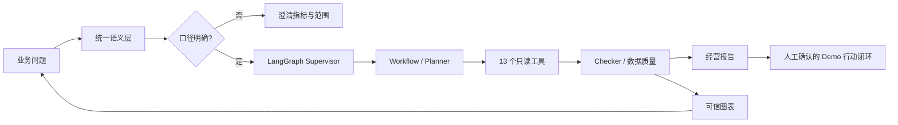

# AI 经营分析助手

面向快消经营管理场景的 AI + BI 可运行 Demo：传统 BI 提供可核对的数据底座，LangGraph Agent 负责问题理解、工具编排、结果校验与解释，ChatBI 提供自然语言问数、可信图表和人工确认的行动闭环。

> 本仓库是公开展示版，只包含固定种子的脱敏 Mock Data。企业、客户、门店、员工、SKU、供应商、订单和经营数字均为虚构或重新生成，不代表任何真实企业及其经营结果。

## 产品能力

| 能力 | 已实现内容 | 可信边界 |
| --- | --- | --- |
| 经营驾驶舱 | ERP Sell-in、POS Sell-out、预算、利润、客户、区域和 SKU 多维分析 | 不同事实口径分开计算，不把 ERP 与 POS 金额相加 |
| 自然语言问数 | 统一语义层识别指标、同义词、维度、期间和工具路由 | “销量”等歧义词先澄清 ERP / POS 口径 |
| Agent 编排 | LangGraph Supervisor、Workflow、Planner、Checker、Reporter | LLM 负责理解与表达，SQL/确定性函数负责数字 |
| 可信图表 | 根据已验证的工具结果生成趋势或对比图，支持点击数据点继续追问 | Checker 未通过时不生成图表 |
| 数据治理 | 13 个公开只读工具、Demo RBAC、质量分级、来源与口径追溯 | 模型不能绕过后端权限或提升数据质量等级 |
| 行动闭环 | 人工确认、负责人、截止日期、执行结果和效果复盘 | 只记录 Demo 待办，不写 ERP、采购或价格系统，不外发通知 |
| 供应链分析 | 到货、BOM、生产、库存、包材采购建议与追溯 | 固定种子 Mock 数据，不代表真实供应链预测效果 |

## 架构



详细产品需求见 [docs/PRD.md](docs/PRD.md)，技术边界见 [docs/ARCHITECTURE.md](docs/ARCHITECTURE.md)，公开数据策略见 [docs/DATA_SAFETY.md](docs/DATA_SAFETY.md)。

## 快速开始

要求 Python 3.10+。

```bash
python3 -m venv .venv
source .venv/bin/activate
pip install -r requirements-agent.txt
python3 run.py --check
python3 run.py
```

浏览器访问：

- 产品目录：<http://127.0.0.1:8765/portal.html>
- AI 经营驾驶舱：<http://127.0.0.1:8765/>
- 对话式经营分析：<http://127.0.0.1:8765/agent.html>
- 供应链分析：<http://127.0.0.1:8765/sc.html>

未配置模型密钥时，Agent 自动使用确定性模板降级，数据查询、Checker 和核心报告仍可运行。若要接入兼容 OpenAI 协议的模型：

```bash
cp .env.example .env
# 只在本地 .env 中填写密钥；.env 已被 .gitignore 排除
```

## 数据口径

- `data/bi_data_layer_v1.db`：公开版 Mock ERP / POS / SFA / 批发数据。
- `data/budget_te_v1.db`：Mock TE 预算。
- `data/budget_v1.db`：Mock 金额预算。
- `data/demo_ext_v1.db`：Mock 会员客户、客户集团和产区补充数据。
- `data/supply_chain_v1.db`：固定种子的 Mock 供应链数据。

所有数据库随仓库提供，启动时只读打开。应用不会自动寻找父目录或历史工作区中的数据库。

## 验证

```bash
python3 -m unittest discover -s tests -v
python3 tools/verify_public_release.py
```

公开版验证覆盖：数据库只读加载、关键接口、自带 Mock 标识、Agent 离线降级、可信图表、行动闭环和敏感内容扫描。验证结果以本地实际命令输出为准。

## 目录

```text
ai-business-analytics-assistant/
├── agent/          # LangGraph Agent、语义层、Checker、图表与行动闭环
├── server/         # 只读 API 与 BI 查询
├── web/            # 无构建步骤的前端页面
├── supply_chain/   # 供应链 Mock 规则、生成与质量门禁
├── data/           # 公开版脱敏 Mock SQLite 数据
├── docs/           # PRD、架构和数据安全说明
├── tests/          # 公开版回归测试
└── tools/          # 发布前安全检查
```

## 项目定位

本项目用于展示 AI 产品经理在经营分析场景中的需求拆解、指标口径、数据治理、Agent/Workflow/Checker 设计、异常降级、权限边界、AI 评估和工程化交付能力。它是作品集 Demo，不宣称已经带来真实业务增长或正式生产上线。
